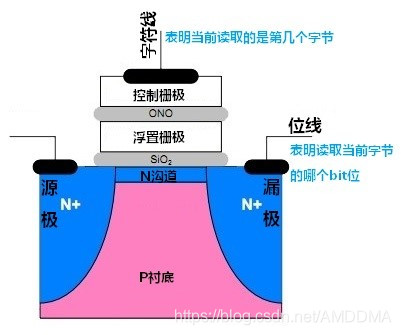
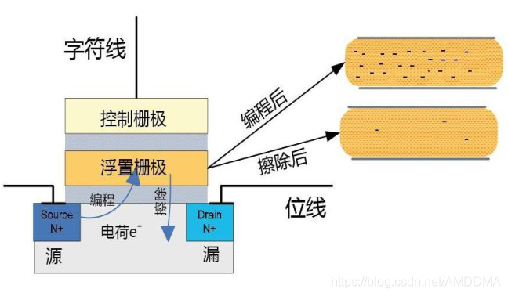
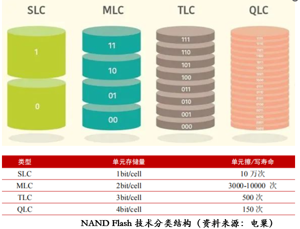
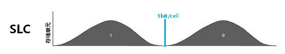
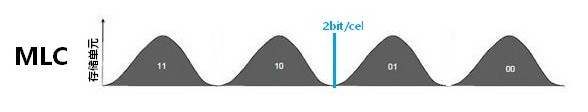
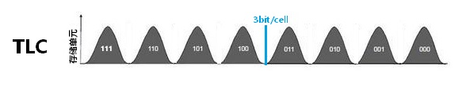
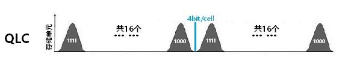
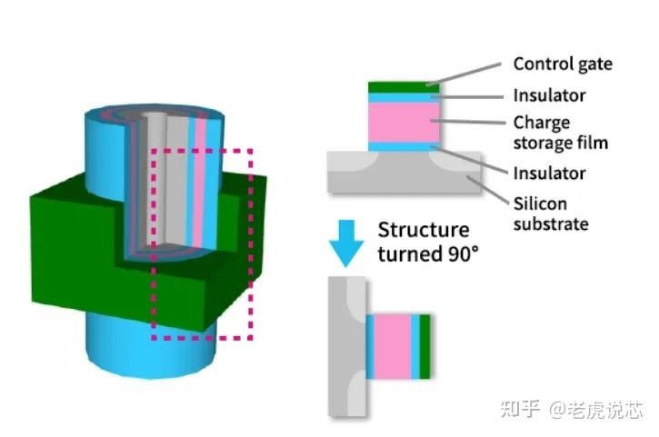

nand在内存中大量使用，它其实对标mos管结构有点相似的

**#### 1.1、基本存储单元**

  

> 浮栅场效应管

存储时，信息存放在浮置栅极中，浮置栅极有无电荷或电荷量来表明当前存储的数据，如下图：

  

------

**#### 1.2、存储颗粒分类**

当前存储颗粒主要分类：SLC、MLC、TLC、QLC | 从结构上又可分为 **2D、3D** 两大类。

单位存储单元下数据存储密度：（一个存储单元要表示的数据类型）

  

> 不同颗粒的存储密度

**###### SLC (Single-Level Cell) 单个存储单元存储1bit数据，即表示2种(2^1)数据状态：0和1**

  

> 存储1bit的情形

**###### MLC (Multi-Level Cell) 单个存储单元存储2bit数据，即表示4种(2^2)数据状态：00,01,10,11**

  

> 存储2bit的情形

**###### TLC (Triple-Level Cell) 单个存储单元存储3bit数据，即表示8种(2^3)数据状态：000,……,111**

  

> 存储3bit的情形

**###### QLC (Quad-Level Cell) 单个存储单元存储4bit数据，即表示16种(2^4)数据状态：0000,……,1111**

  

> 存储4bit的情形

**颗粒配合制作工艺实现：2D和3D Flash技术，2D最早在SLC阶段应用广泛，3D在TLC阶段应用广泛，具体结构区分：**

**2D内部结构：**

  

**3D内部结构：**

  

**3D NAND 内部结构**

  

  

其中间部分细节放大图为：

  

