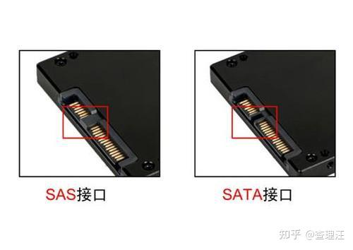
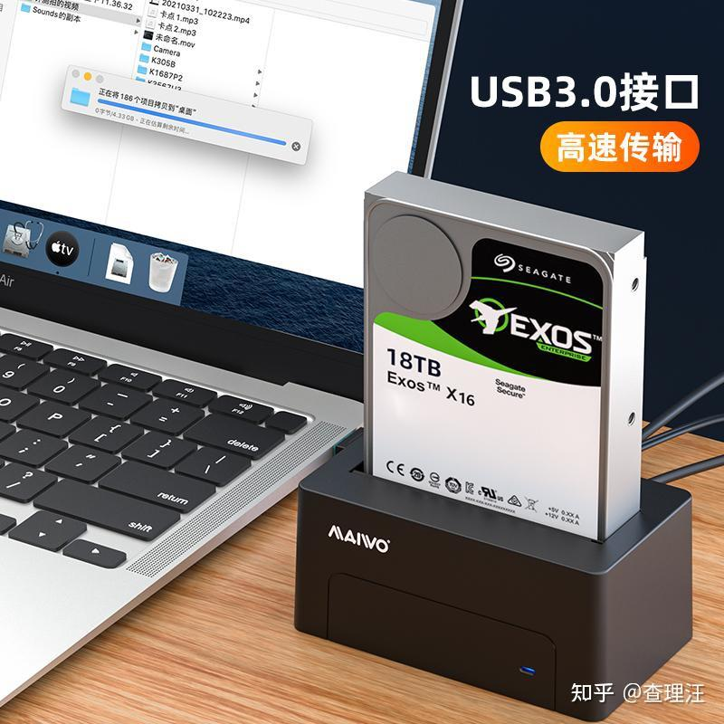

# 一、总线标准

首先我们要知道，NVMe 和 AHCI 是协议。NVMe 协议是专门为 PCIe 通道的固态硬盘设计的，而 AHCI 是专门为 SATA 通道的硬盘设计的，PCIe 和 SATA 都是通道。

现在越来越多人把 AHCI 协议就叫成 SATA 协议，我们下面就用 SATA 协议这个名称。

M.2 接口有两种，一种走 SATA（AHCI）的，另外一种走 PCIe（NVMe）的。

走 SATA 的速度跟传统 SATA 接口的没区别，就是接口变成了 M.2 的了。

走 PCIe 的就是我们说的 NVMe，性能比 SATA 强了很多。

一般来说，在购买 M.2 SSD 的时候，商家都会把支持 NVMe 的明显标出来（因为这是一个很大的卖点），而不支持的一般都不标。

  

## SATA

SATA 硬盘可以直接使用在 SAS 的环境中，从接口标准上而言，SATA 是 SAS 的一个子标准。

SATA 是一种串行总线（或串行 ATA），是用于连接 SSD、HDD 和光盘驱动器的存储协议。

  

  

### 1、SATA 总线标准传输速度

- SATA 1.0 可以达到 150 MB/s 的速度，即 1.5 Gbps。
- SATA 2.0 可以达到 300 MB/s 的速度，即 3 Gbps。

  

通用的是 SATA 3.0，可以达到 600 MB/s 的速度，即 6 Gbps。

  

SATA 2 和 SATA 3 主板硬盘接口外观基本相同，不过很多中低端主板中采用 SATA 2 和 SATA 3 双接口混合模式，像 AMD 平台的 A75、Intel 平台的 B75、H81、B85 主板均为 SATA 2、SATA 3 双接口混合模式，而一些中高端主板，如 A88、H87、Z87 等主板则全为 SATA 3 接口。

### 2、SATA 总线标准主要支持接口形式

SATA、mSATA、mini-mSATA、B-key M.2 等。

### 3、SATA 与 PCIe 的区别

SATA 与 PCIe 都是总线标准，两者的区别在于 SATA 通常使用 AHCI 协议标准，SATA 3.0 的理论传输速率为 6 Gbps；而 PCIe 的传输速度取决于 PCIe 的版本、通道数量等因素。使用 PCIe 接口的 SSD 既可以采用 AHCI 协议，也可以采用 NVMe 协议。

（* NVMe 标准是专门针对 PCIe 等高速互连总线设计的 SSD 通信协议。）

  

## PCIe 总线

现在常用的是 3.0 版本和 4.0 版本。

  

由于在很多年以前，电脑主板上不同的设备所使用的总线接口是完全不一样的，网卡用网卡的总线和接口，硬盘用硬盘的总线和接口。这就导致主板上的接口只能对应一个硬件设备，这就造成了主板扩展的局限性，也对硬件规格的统一带来了很多的不便。

  

由于兼容性好，ISA 总线成为了上个世纪 80 年代最广泛使用的系统总线。不过由于 ISA 使用的是并行总线，当时的抗干扰技术也不成熟，就导致 ISA 总线的带宽不能设计得很高，只能达到 8 MB/s 的速率。

  
  

PCI 总线相比 ISA 总线，带宽升级到了 132 MB/s，速度提升非常明显。再就是支持自动配置，即插即用。

PCI 总线也并不是完美的。PCI 总线跟 ISA 总线都是使用了并行总线设计，所以传输速度也受到了影响。再就是 PCI 总线的带宽共享机制，在高负载下，其他设备可能会出现抢带宽的现象，也不支持热插拔。

  

为了解决 PCI 总线的缺陷，技术再一次进行了升级革新，也就是本篇文章要说的 PCIe 总线了。

PCIe 总线有两种存在形式，一种是接口，一种是通道。当 PCIe 以接口形式存在的时候，就是主板上横着的长槽。

  

PCIe 接口主要有四种尺寸：X1、X4、X8、X16。一般情况下，四种尺寸的插槽最大带宽是不同的。当然，也有 X16 长度的插槽，使用的是 X4 带宽。这样情况下，X16 长度、X4 带宽的插槽速度就跟 X4 长度、X4 带宽的插槽一样了。

  

另外还有一种接口也是借助 PCIe 通道传输数据的，那就是 M.2 接口，也就是 M.2 固态硬盘的接口。虽然这个跟 PCIe 接口模样不同，但依旧走的是 PCIe 通道。

  

## SAS 总线

SAS 的接口技术可以向下兼容 SATA。具体来说，二者的兼容性主要体现在物理层和协议层的兼容。

在物理层，SAS 接口和 SATA 接口完全兼容，SATA 硬盘可以直接使用在 SAS 的环境中。从接口标准上而言，SATA 是 SAS 的一个子标准，因此 SAS 控制器可以直接操控 SATA 硬盘。

但是 SAS 却不能直接使用在 SATA 的环境中，因为 SATA 控制器并不能对 SAS 硬盘进行控制。

在协议层，SAS 由 3 种类型协议组成，根据连接的不同设备使用相应的协议进行数据传输。

- 串行 SCSI 协议（SSP）用于传输 SCSI 命令。
- SCSI 管理协议（SMP）用于对连接设备的维护和管理。
- SATA 通道协议（STP）用于 SAS 和 SATA 之间数据的传输。

因此，在这 3 种协议的配合下，SAS 可以和 SATA 以及部分 SCSI 设备无缝结合。

  

目前个人电脑主板是不能直接连接 SAS 硬盘读写的。如果想使用 SAS 硬盘，需要加 SAS 卡、阵列卡之类的。不过目前有部分厂商开发出 SAS 硬盘盒，如麦沃的 K308SAS，就支持 SAS 硬盘转接成 USB 3.0，可以直接用在个人电脑上。

SAS 硬盘一般使用在企业服务器上。

  

现在常用的是 SAS 3.0。

  

同时，价格上，SAS 硬盘普遍比 SATA 硬盘价格高。如希捷银河系企业级硬盘，SAS 硬盘比 SATA 贵了 400～500 元。

## mSATA 接口

如果打开 2.5 寸的固态硬盘，会发现大大的盒子里面只有一小块电路板。

  

因此这个接口出现了，只是为了缩小 SATA 硬盘的体积。速度性能和 SATA 一样，在笔记本中用得多。后来 M.2 出现后就被淘汰了。

  

## M.2 接口

  
  

按照接口类型分，可以把 M.2 接口分为 Socket 2 和 Socket 3。

- Socket 2 也可以叫做 B-key，支持 SATA、PCIe x2。
- Socket 3 也可以叫做 M-key，支持 SATA、PCIe x4。

  

SSD 的金手指有 B-key、M-key、B&M-key 三种，但是主板上的 M.2 接口只有 B-key 和 M-key 两种。

当主板上的 M.2 接口是 B-key 时，只能够插上 B&M-key 和 B-key 的 SSD，M-key 的插不上去，如下图：

  

当主板上的 M.2 接口是 M-key 时，只能够插上 B&M-key 和 M-key 的 SSD，B-key 的插不上去，如下图：

  

既可以走 SATA 总线、AHCI 协议，也可以走 PCIe 总线、AHCI 协议，还可以走 PCIe 总线、NVMe 协议。

参考文章：[M.2 引脚相关介绍（CSDN）](https://blog.csdn.net/qq_28713413/article/details/131985630)

此为 M.2 的引脚的文章。