**一、总线标准**

首先我们要知道nvme和ahci是协议，nvme协议是专门为pcie通道的固态硬盘设计的，而achi是专门为sata通道的硬盘设计的，pcie和sata都是通道。

现在越来越多人，把achi协议就叫成sata协议，我们下面就用sata协议这个名称。

m2接口有两种，一种走sata(achi)的，另外一种走pcie(nvme)的。

走sata的速度跟传统sata接口的没区别，就是接口变成了m2的了。

走pcie的就是我们说的nvme ，性能比sata强了很多。

一般来说，在购买m.2 ssd的时候，商家都会把支持nvme的明显标出来（因为这是一个很大的卖点），而不支持的一般都不标。

  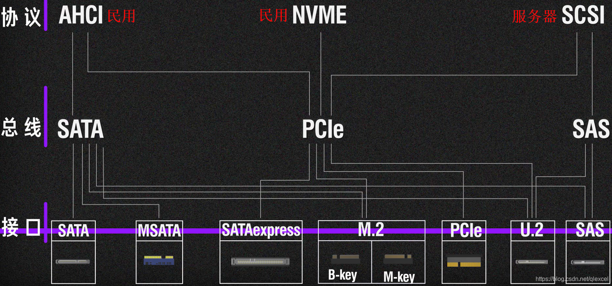

## SATA

SATA 是一种串行总线（或串行 ATA），是用于连接 SSD、HDD 和光盘驱动器的存储协议。

  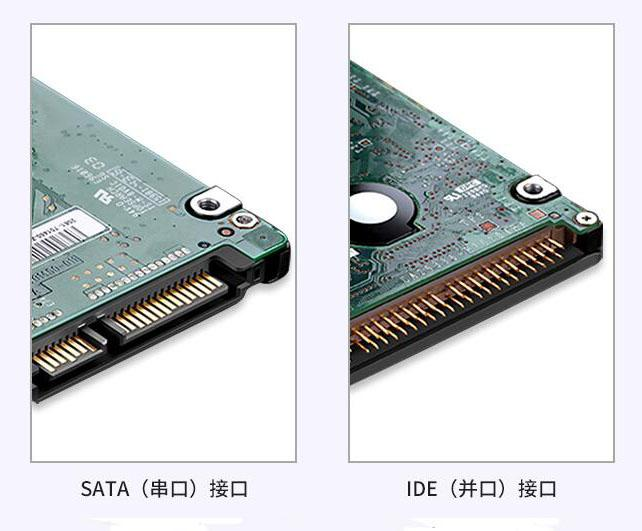

  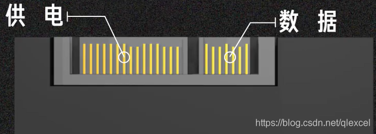

### 1、SATA 总线标准传输速度：

SATA 1.0 可以达到 150 MB/s 的速度，即 1.5 Gbps；

SATA 2.0 可以达到 300 MB/s 的速度，即 3 Gbps；

  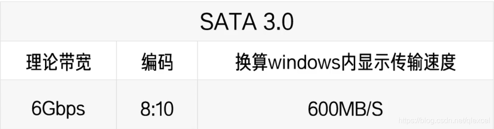

通用的是 SATA 3.0，可以达到 600 MB/s 的速度，即 6 Gbps。

  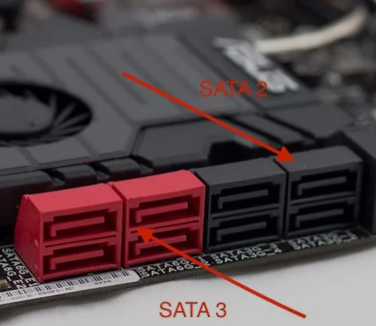

SATA 2和SATA 3主板硬盘接口外观基本相同，不过很多中低端主板中采用SATA 2和SATA 3双接口混合模式，像AMD平台的A75，Intel平台的B75、H81、B85主板均为SATA 2SATA 3双接口混合模式，而一些中高端主板，如A88、H87、Z87等主板则全为SATA 3接口

### 2、SATA 总线标准主要支持接口形式：

SATA、mSATA、mini-mSATA、B-key M.2 等。

### 3、SATA 与 PCIe 的区别：

SATA 与 PCIe 都是总线标准，两者的区别在于 SATA 通常使用 AHCI 协议标准，SATA 3.0 的理论传输速率为 6 Gbps；而 PCIe 的传输速度取决于 PCIe 的版本、通道数量等因素。使用 PCIe 接口的 SSD 既可以采用 AHCI 协议，也可以采用 NVMe 协议。

（* NVMe 标准是专门针对 PCIe 等高速互连总线设计的 SSD 通信协议。）

  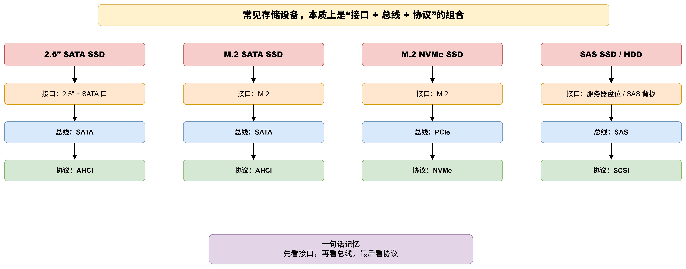

## PCIe总线

现在常用的是3.0版本和4.0版本

  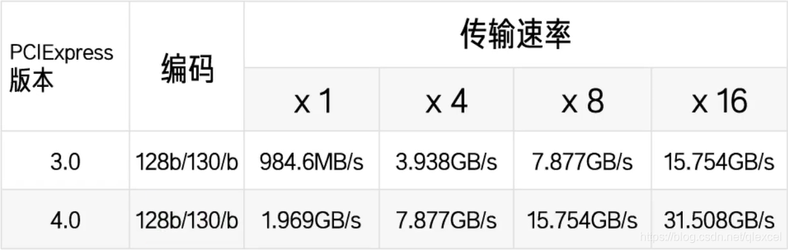

由于在很对年以前，电脑主板上不同的设备所使用的的总线接口是完全不一样的，网卡用网卡的总线和接口，硬盘用硬盘的总线和接口。这就导致主板上的接口，只能对应一个硬件设备，这就造成了主板拓展的局限性，也对硬件规格的统一带来了很多的不便。

  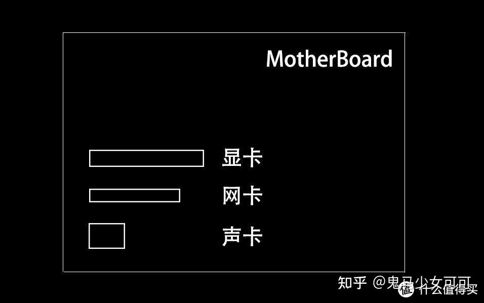

由于兼容性好，ISA总线成为了上个世纪80年代最广泛使用的系统总线，不过由于ISA使用的是并行总线，当时的抗干扰技术也不成熟，就导致ISA总线的带宽不能设计的很高，只能达到8MB/s的速率

  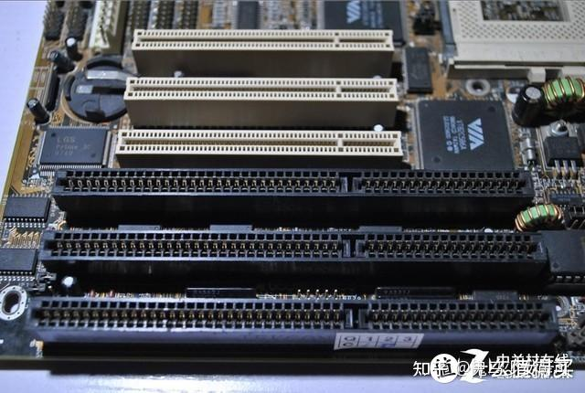
  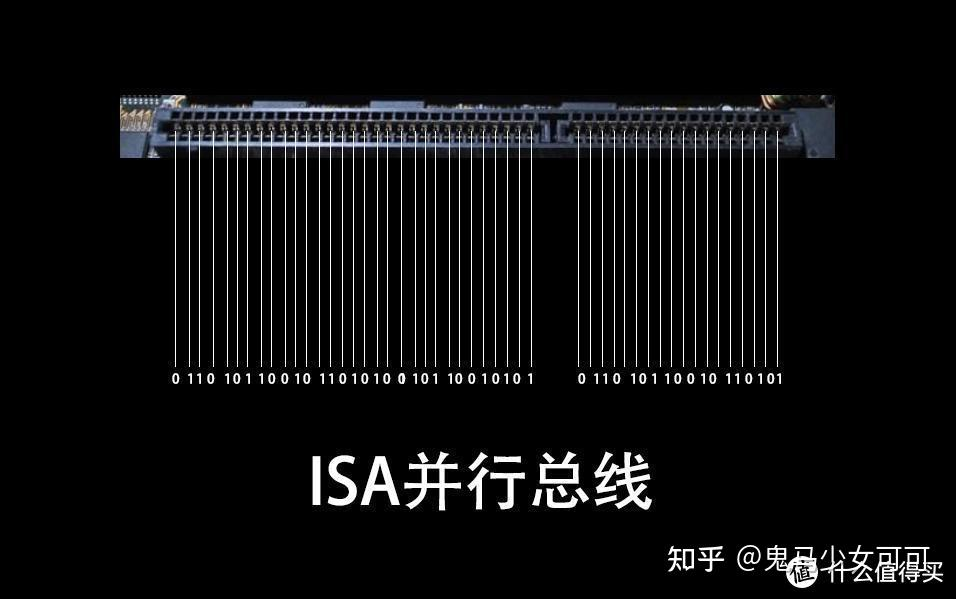

PCI总线相比ISA总线带宽升级到了132MB/s，速度提升非常明显。再就是支持自动配置，即插即用。PCI总线也并不是完美的，PCI总线跟ISA总线都是使用了并行总线设计，所以传输速度也受到了影响。再就是PCI总线的带宽共享机制，在高负载下，其他设备可能会出现抢带宽的现象，也不支持热插拔。

  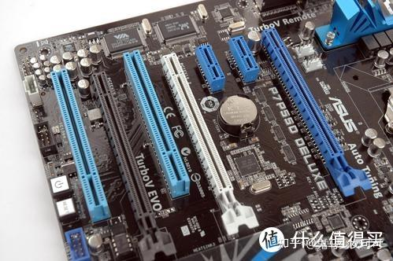

为了解决PCI总线的缺陷，技术再一次进行了升级革新，也就是本篇文章要说的PCIe总线了。PCIe总线有两种存在形式，一种是接口、一种是通道。当PCIe以接口形式存在的时候，就是主板上横着的长槽。

  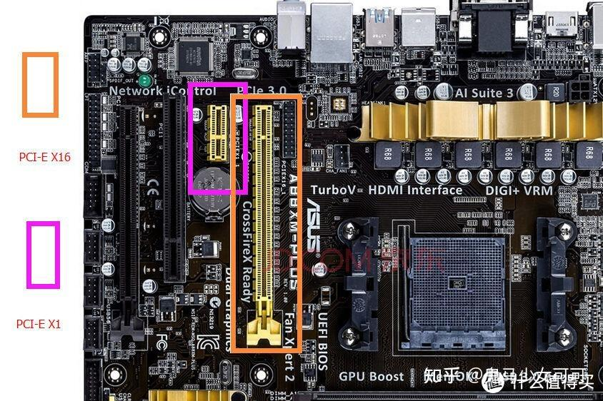

PCIe接口主要有四种尺寸，X1、X4、X8、X16，一般情况下四种尺寸的插槽最大带宽是不同的。当然，也有X16长度的插槽，使用的是X4带宽，这样情况下X16长度X4带宽是跟X4长度X4带宽速度一样的。

  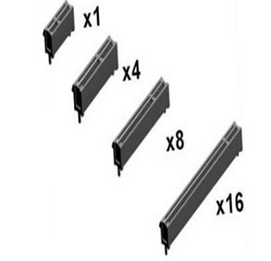

另外还有一种接口也是借助PCIe通道传输数据的，那就是M.2接口，也就是M.2固态硬盘的接口。虽然这个跟PCIe接口模样不同，但依旧走的PCIe通道。

  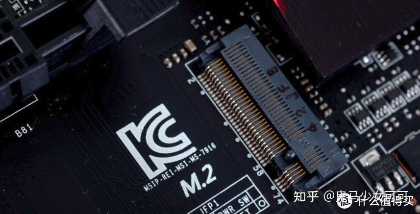

## SAS总线

现在常用的是SAS 3.0

  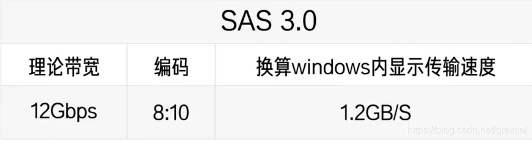

## MSATA接口

如果打开2.5寸的固态硬盘会发现，大大的盒子里面只有一小块电路板

  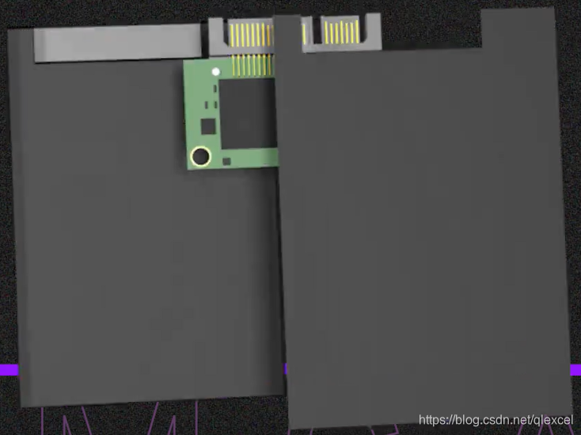

因此这个接口出现了，只是为了缩小SATA硬盘的体积。速度性能和SATA一样。在笔记本 中用的多。后来M.2出现后就被淘汰了

  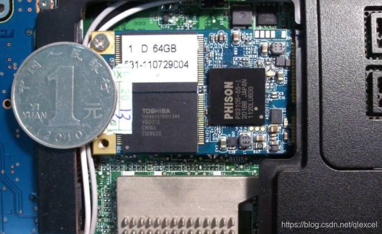

## M.2接口

  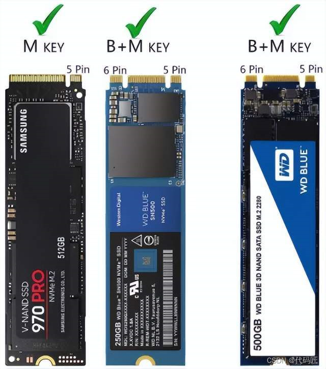
  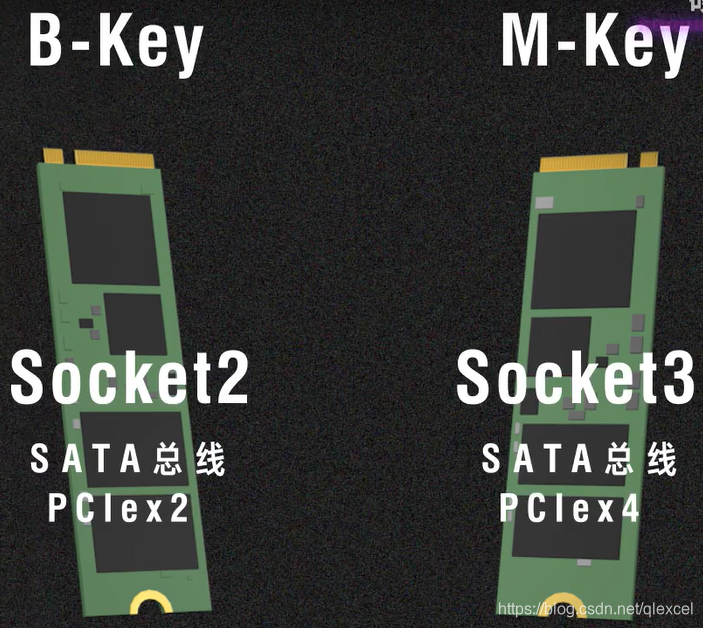

按照接口类型分，可以把m.2接口分为Socket 2和Socket 3

Socket 2也可以叫做B key，支持sata，pcie x2

Socket 3也可以叫做M key，支持sata，pcie x4

  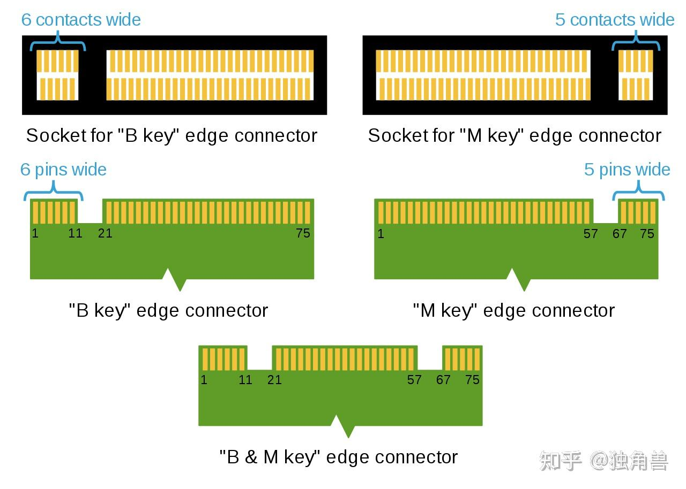

ssd的金手指有b key，m key ，b&m key三种，但是主板上的m.2接口只有b key和m key两种。

当主板上的m2接口是b key时，只能够插上b&m key和b key的ssd，m key的插不上去，如下图:

  

当主板上的m2接口是m key时，只能够插上b&m key和m key的ssd，b key的插不上去，如下图:

  

既可以走SATA总线AHCI协议，也可以走PCIe总线AHCI协议，还可以走PCIe总线NVME协议

https://blog.csdn.net/qq_28713413/article/details/131985630

