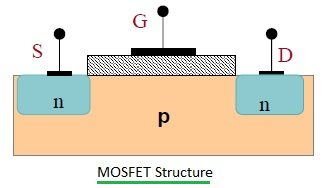
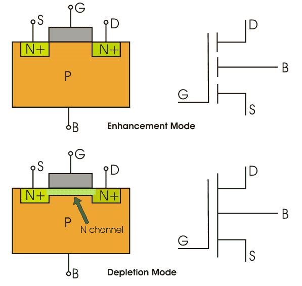
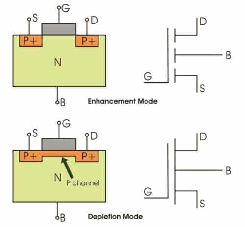
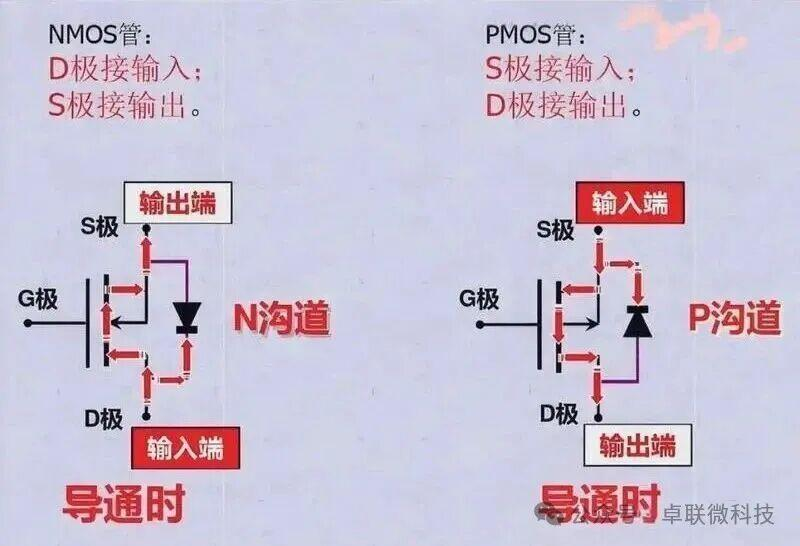

关于mos管其实原理不是很难，但由于它是基础同时会涉及到后续文章的内容，所有需要单独拎起来讲一下。

首先它的结构就四个部分源极（S）、漏极（D）、**栅极（G）**和衬底（B）[Source (S), Drain (D), Gate (G), and body (B)] 

衬底（B）通常与源极相连，使器件实际使用的端子数变为三个。其工作原理为通过改变电荷载流子（电子或空穴）流经的沟道宽度，实现对电流的控制。

  

电荷载流子从源极进入沟道，从漏极流出。沟道宽度由位于源极与漏极之间的栅极电极上的电压控制，栅极与沟道之间由一层极薄的金属氧化物实现绝缘。

那如何让源极与漏极的电流来流动起来呢，其实就在栅极，mos管的工作就是当栅极通电时，源极便与漏极通电.

其实原理很基础，当g（栅极）施加电压时，它下方氧化物层的电子便会收到吸引力，那么源极与漏极和电子层便形成通路。

  

  

其实n沟道与p沟道主要区别就是电流方向

  

他们实际其实就是底部的化学  