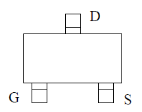
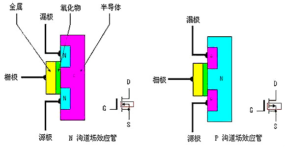

# MOS 管的工作原理

关于 MOS 管，其实原理并不是很难。但由于它是基础元器件，同时也会涉及后续文章的内容，所以有必要单独拎出来讲一下。

首先，它的结构主要有四个部分：源极（S）、漏极（D）、栅极（G）和衬底（B）[Source (S), Drain (D), Gate (G), and Body (B)]。

  

衬底（B）通常与源极相连，使器件在实际使用时通常只需要三个引脚。它的工作原理是通过改变沟道的导电能力，实现对电流的控制。

  

电荷载流子通过沟道在源极与漏极之间运动。沟道的形成与导电能力由栅极电压控制，而栅极与沟道之间则由一层极薄的绝缘介质隔开。

那么，如何让源极与漏极之间产生电流呢？其实，关键就在栅极。MOS 管的工作原理，就是通过控制栅极电压，来控制源极与漏极之间的导通状态。

其实原理很基础。当 G（栅极）施加合适的电压时，栅极产生的电场会影响下方半导体中的载流子分布，使其形成导电沟道。这样，在源极与漏极之间存在合适电压差的情况下，电流便可以流动。

  
  

其实，N 沟道与 P 沟道 MOS 管的主要区别在于导电载流子的类型、导通条件以及相应的电流特性。

  

它们的底层区别主要在于半导体的掺杂类型和内部结构，而不是简单地由两种相反的化学成分构成。

  

